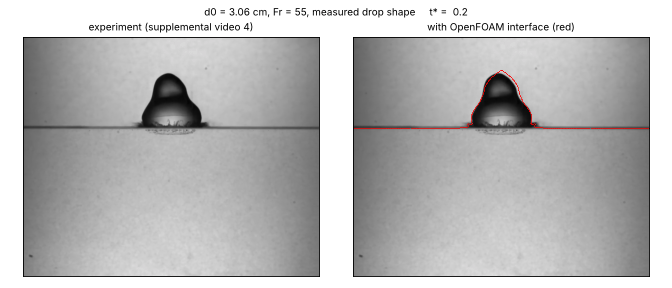
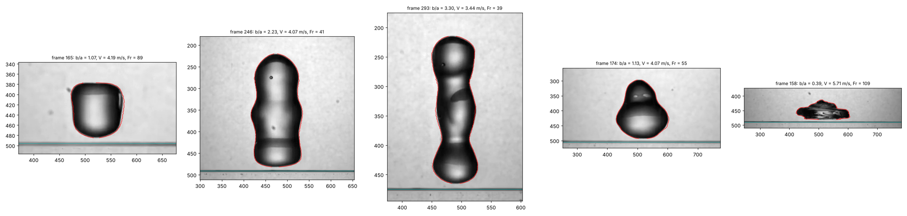
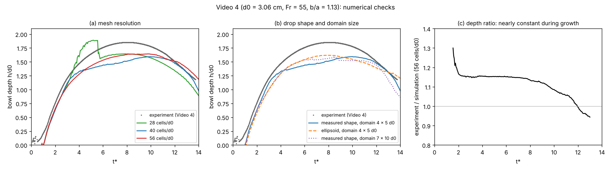
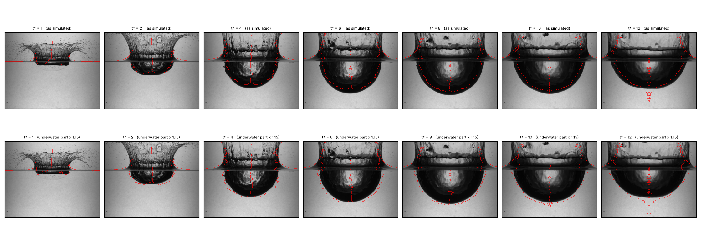
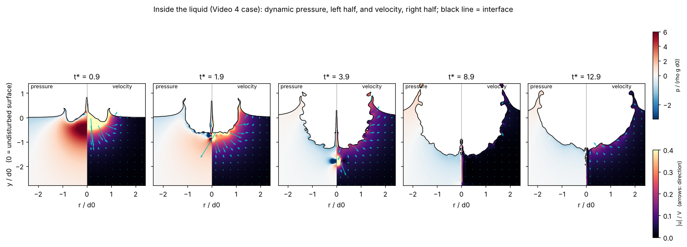
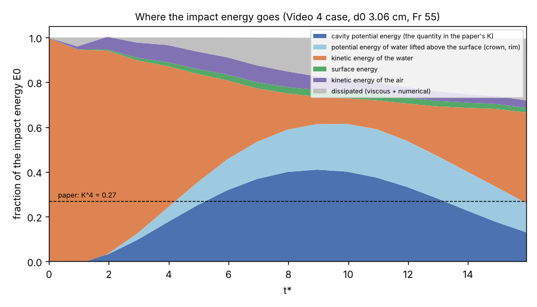

# Large water drops impacting a deep pool: simulations alongside experiments

Axisymmetric OpenFOAM simulations of 2–4 cm water drops falling into a deep water pool,
compared frame by frame with the experiments of

> S. Dighe, D. K. Maity, J. N. Fonnesbeck, S. Dutta and T. T. Truscott,
> *Extremely large water droplet impact onto a deep liquid pool*,
> Phys. Rev. E **109**, 045107 (2024), and its supplemental videos.

The aim is to show what a simulation adds to high-speed imaging of this flow: the pressure and
velocity inside the liquid, the full energy budget, and the effect of drop shape and impact
speed taken separately. This is independent work, not affiliated with the authors.

 
<em>Supplemental video 4 (d0 = 3.06 cm, released from 95 cm). Left: experiment. Right: the same
frames with the simulated air–water interface (red), at the same scale and time after impact.
Video frames: Dighe et al. (2024), CC BY 4.0.</em>

## Summary

- **Inputs taken from the experiment.** Drop shape, impact speed and impact time were measured
  from the last video frames before impact. The simulation starts from the measured drop shape,
  not an idealised one.
- **Above the water, simulation and video coincide at the true scale.** The crown position,
  height and shape match the frames with no adjustment.
- **Below the water, the simulated cavity is uniformly about 15 % smaller than the cavity in the
  video**, in both depth and width, and at all times during growth. A single scale factor of
  about 1.15 brings them into agreement, which is consistent with optical magnification of the
  underwater image by the tank wall and water (to be confirmed with the authors' calibration).
- **The simulation accounts for the impact energy.** The paper finds that about 29 % of the
  drop's kinetic energy is stored as cavity potential energy. The simulation shows where the
  rest is at maximum depth: about 20 % in water lifted above the surface (crown and rim), 12 %
  still in motion, 6 % in the air, 3 % in surface energy, and at most 17 % dissipated.

## 1. Cases and inputs

The five supplemental videos were analysed. For each, the drop outline in the last frame before
impact gives the drop shape (axis ratio b/a and full profile), the length scale (from the known
drop volume) and the impact speed (from the drop motion over 12 frames at 7000 frames/s).

| Video | Paper figure | d0 (cm) | b/a | V (m/s) | Fr = V²/(g d0) | Free-fall check √(2gH) |
|---|---|---|---|---|---|---|
| 1 | Fig. 1a, near-spherical, H = 95 cm | 2.00 | 1.07 | 4.19 | 89 | 4.32 |
| 2 | Fig. 1b, prolate, H = 95 cm | 4.13 | 2.23 | 4.07 | 41 | 4.32 |
| 3 | Fig. 3a, prolate, H = 65 cm | 3.06 | 3.30 | 3.44 | 39 | 3.57 |
| 4 | Fig. 3b, near-spherical, H = 95 cm | 3.06 | 1.13 | 4.07 | 55 | 4.32 |
| 5 | Fig. 3c, oblate, H = 185 cm | 3.06 | 0.39 | 5.71 | 109 | 6.02 |

The measured speeds are 3–6 % below free fall, as expected from air drag.

 
<em>Last frame before impact in videos 1–5, with the measured outline (red). The real drops are
not ellipsoids: a barrel, a three-lobed column, a thin wavy column, a pear and a rough disk.
Frames: Dighe et al. (2024), CC BY 4.0.</em>

## 2. Method

- **Solver:** OpenFOAM v2606, `interFoam` (incompressible two-phase flow, algebraic volume of
  fluid with interface compression, surface tension as a continuum surface force), laminar.
- **Geometry:** axisymmetric 5° wedge. Pool 5 d0 deep, domain radius 4 d0, 4 d0 of air above.
  Pool floor no-slip, side wall free-slip, open atmosphere at the top.
- **Initial drop:** the measured outline revolved about the axis and written into the mesh with
  exact cell volume fractions (drop volume reproduced to 0.01 %), or, for comparison, the
  ellipsoid with the same b/a assumed in the paper. The drop starts 0.05 d0 above the surface
  with the measured speed.
- **Mesh:** uniform square cells, 40 per d0 (0.77 mm for d0 = 3.06 cm), about 58,000 cells.
- **Measured quantities:** cavity depth h(t), taken as the depth of the cavity floor fitted
  between r = 0.2 and 0.6 d0 and extrapolated to the axis. The same definition is applied to the
  video frames, so that thin numerical features on the symmetry axis do not enter the comparison.

### Numerical checks (video 4)

| Check | Maximum cavity depth h/d0 | Change |
|---|---|---|
| 40 cells per d0 (reference) | 1.60 | — |
| 56 cells per d0 | 1.64 | +3 % |
| 28 cells per d0 | 1.89, peaks too early | under-resolved |
| Domain 7 d0 × 10 d0 (tank size) instead of 4 d0 × 5 d0 | 1.60 | < 0.5 % |
| Ellipsoidal drop instead of measured shape | 1.62 | +1.5 % |

 
<em>(a) Mesh resolution, (b) drop shape and domain size, (c) ratio of measured to simulated depth,
nearly constant (about 1.15) during cavity growth.</em>

## 3. Comparison with the experiment

 
<em>Video 4 with the simulated interface (red). Top: as simulated. Bottom: the underwater part
scaled by 1.15. The crown above the surface matches without scaling; the cavity below matches
in width and depth with one scale factor from t* = 2 to 8. t* = V t / d0 after impact.
Frames: Dighe et al. (2024), CC BY 4.0.</em>

- **Cavity growth (t* < 8):** simulated and measured depth differ by a constant factor of
  about 1.15, in width as well as depth. A physical error, such as missing dissipation, would
  grow with time instead. A uniform underwater magnification of this size corresponds to a
  camera roughly 20 cm from the tank wall in a simple pinhole model.
- **Cavity collapse (t* > 10):** the simulated cavity retracts later than in the experiment.
  This difference is physical and is the next point to investigate.
- **Against the paper's published data:** for the 4.14 cm drop series of Fig. 2(a), the
  simulated maximum depth at Fr = 30 is 2.05 d0 against about 1.93 d0 in the paper (+6 %).

## 4. What the simulation adds

### Pressure and flow inside the liquid

 
<em>Dynamic pressure (left halves, in units of ρ g d0) and velocity (right halves, in units of
the impact speed V), video 4 case.</em>

| t* | What the fields show |
|---|---|
| 0.9 | Impact: a pressure peak above 6 ρ g d0 under the drop, whose width is set by the drop width. This is the "impact energy flux" argument of the paper made visible. |
| 1.9 | The high pressure has moved to the cavity floor; the liquid spreads out as a growing hemisphere and feeds the crown at the rim. |
| 3.9 | The cavity keeps growing while the radial flow decelerates. |
| 8.9 | Maximum depth: the liquid is nearly at rest, and the pressure next to the cavity is below hydrostatic. This deficit drives the collapse. |
| 12.9 | Collapse: the flow converges on the axis at the cavity floor and starts the Worthington jet. |

### Where the impact energy goes

 
<em>Energy budget, as fractions of the drop's kinetic energy at impact, from the simulated
fields. Dashed line: cavity energy fraction implied by the paper's K = 0.72.</em>

At maximum depth (t* ≈ 9):

| Share of the impact energy | |
|---|---|
| Potential energy of the cavity (the quantity behind the paper's K) | 41 % |
| Potential energy of water lifted above the surface (crown, rim) | 20 % |
| Kinetic energy still in the water | 12 % |
| Kinetic energy of the air | 6 % |
| Surface energy | 3 % |
| Dissipated (viscous and numerical; an upper bound) | 17 % |

Most of the energy not stored in the cavity is therefore not lost: about a fifth is in water
lifted above the pool surface, and another fifth is still in motion. The simulated cavity
fraction (41 %, K ≈ 0.80) is higher than the paper's fitted 27–29 %, which is a single fit
across all drop sizes; this difference is open.

## 5. In progress

- Videos 1, 2, 3 and 5 with measured and ellipsoidal drop shapes (prolate, oblate and 2 cm cases).
- The remaining Fig. 2(a) cases (d0 = 4.14 cm, Fr = 45–100).
- Separating drop shape from impact speed: fixed Fr with b/a from 0.5 to 2.5, and fixed b/a with
  Fr from 30 to 150, to test the scaling h_max/d0 ∝ (Fr b/a)^1/4 as cause and effect.
- A passive tracer marking the drop liquid, to show where it goes and to test the "second impact"
  of prolate drops on the cavity floor.

## 6. Limitations

- Axisymmetric: the breakup of the crown rim into fingers and droplets, and bag-shaped drops,
  are not represented.
- The symmetry axis produces thin, mesh-dependent features (a central spike, a cusp at the cavity
  floor, small bubbles). They are excluded from the depth measurement and from the interpretation.
- The drop starts with a uniform velocity; internal motion from its oscillation is not included.
- The dissipated energy includes numerical dissipation of the volume-of-fluid scheme.

## Code and data

The simulation set-up, the image analysis and the post-processing scripts are available on
request.

**Author:** Dr. Ilemona Sunday Omeje, SOREC LLC — omejeilemona@gmail.com

© 2026 Ilemona Sunday Omeje. All rights reserved. Video frames and the experimental data shown in
the figures are from Dighe et al., Phys. Rev. E 109, 045107 (2024), published under CC BY 4.0.
