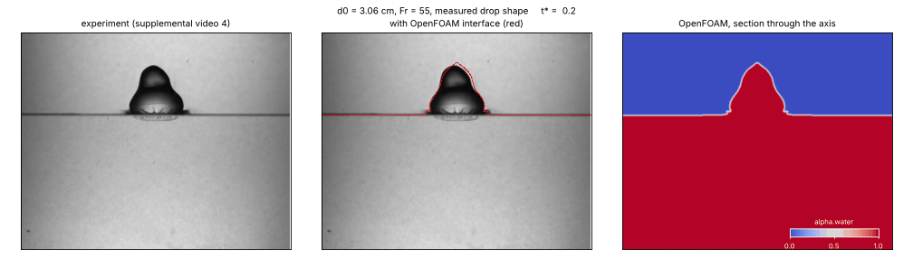
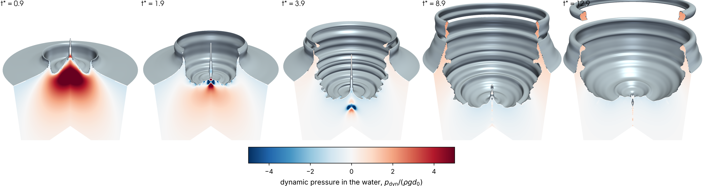
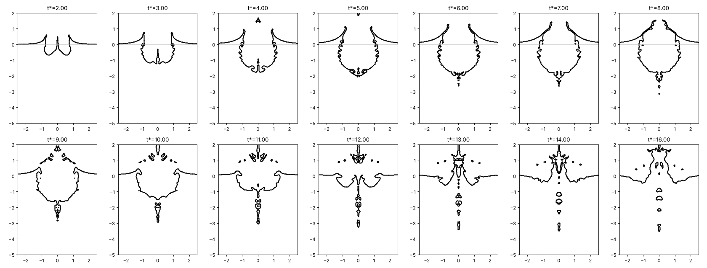

# Large water drops falling into a deep pool: reproducing and explaining the experiments with simulation

This page reproduces, with numerical simulation, the experiments of

> S. Dighe, D. K. Maity, J. N. Fonnesbeck, S. Dutta and T. T. Truscott,
> *Extremely large water droplet impact onto a deep liquid pool*,
> Phys. Rev. E **109**, 045107 (2024),

and uses the simulation to look at what the high-speed camera cannot see: the pressure and flow
inside the pool, and where the impact energy goes. It is independent work, not affiliated with the
authors.

<p align="center">
<br>
<em>Supplemental video 4 of the paper (a 15 ml drop, d0 = 3.06 cm, released from 95 cm). Left:
experiment. Middle: the same frames with the simulated air–water interface in red. Right: the
simulated liquid fraction alpha.water (red water, blue air) on a section through the axis. All
three panels are at the same scale and the same time after impact. Video frames: Dighe et al.
(2024), CC BY 4.0.</em>
</p>

---

## 1. The experiment and its main findings

Water drops of 1 to 6 cm were released from 65–215 cm into a 40 cm deep pool and filmed at
7000 frames/s above and below the surface. Large drops do not stay spherical as they fall: they
oscillate between tall (prolate) and flat (oblate) shapes, and the largest flatten under air drag.
The paper reports:

1. **The drop shape at impact controls the cavity.** Prolate drops (height b > width a) make deep,
   narrow cavities; oblate drops make shallow, wide ones.
2. **The cavity aspect ratio follows the drop aspect ratio:** h_max / D_h = 0.58 (b/a)^1/2.
3. **The maximum depth scales with Froude number and drop shape:**
   h_max / d0 = 0.77 (Fr · b/a / 3)^1/4, with Fr = V² / (g d0).
4. **Only about 29 % of the drop's kinetic energy is stored in the cavity** at maximum depth
   (energy conversion factor K = 0.72, K⁴ = E_cavity / E_kinetic).
5. **The cavity takes longer to retract at higher Froude number.**

The aim here is to reproduce these findings from first principles, and then to explain them using
quantities that are not accessible in the images.

## 2. The model

### Equations

Water and air are treated as one incompressible fluid whose properties change across the interface.
A volume fraction α marks the water (α = 1 in water, 0 in air, in between at the interface).
Density and viscosity are mixed linearly:

```math
\rho = \alpha\,\rho_w + (1-\alpha)\,\rho_a, \qquad \mu = \alpha\,\mu_w + (1-\alpha)\,\mu_a .
```

**Mass conservation** (incompressible flow):

```math
\nabla\cdot\mathbf{u} = 0 .
```

**Momentum conservation** (Navier–Stokes), with gravity and surface tension:

```math
\frac{\partial(\rho\mathbf{u})}{\partial t} + \nabla\cdot(\rho\,\mathbf{u}\mathbf{u}) = -\nabla p + \nabla\cdot\left[\mu\left(\nabla\mathbf{u} + \nabla\mathbf{u}^{T}\right)\right] + \rho\,\mathbf{g} + \sigma\,\kappa\,\nabla\alpha .
```

**Transport of the interface** (volume of fluid):

```math
\frac{\partial\alpha}{\partial t} + \nabla\cdot(\alpha\,\mathbf{u}) + \nabla\cdot\left[\alpha(1-\alpha)\,\mathbf{u}_c\right] = 0 ,
```

where the last term is an artificial compression velocity u_c, directed normal to the interface,
that keeps the interface sharp (one to two cells thick). Surface tension acts only at the
interface, through the curvature

```math
\kappa = -\nabla\cdot\left(\frac{\nabla\alpha}{|\nabla\alpha|}\right).
```

The three equations are solved together at every time step: the velocity moves the interface, the
interface position sets the density, viscosity and surface-tension force, and these feed back into
the velocity and pressure.

### Numbers that set the physics (video 4 case)

| Number | Definition | Value | Meaning |
|---|---|---|---|
| Froude | V² / (g d0) | 55 | impact inertia vs gravity: controls how deep the cavity goes |
| Weber (liquid) | ρ_w V² d0 / σ | 7 000 | inertia vs surface tension |
| Reynolds | V d0 / ν_w | 1.2 × 10⁵ | inertia vs viscosity |
| Bond | ρ_w g d0² / σ | 127 | gravity vs surface tension |

Inertia and gravity dominate; surface tension and viscosity are small for the cavity itself (they
matter for the breakup of the crown rim into droplets). This is why the paper's Froude-number
scaling works for cm-size drops, and why the cavity can be simulated well without resolving the
thin features of the splash. (The paper quotes a Weber number of 2–40 based on the air density;
it describes the drop's deformation in flight, not the impact.)

### How the experiment is set up in the simulation

- **Geometry:** the flow is assumed symmetric about the vertical axis, so a thin wedge-shaped slice
  is computed instead of the full tank. The pool is 5 d0 deep and 4 d0 in radius, with 4 d0 of air
  above it. The pool floor is a solid wall, the side is a free-slip wall, the top is open air.
- **The drop:** its shape and speed are **taken from the video**. In the last frame before
  impact, the drop outline gives its width profile, row by row; with the known volume this sets the
  length scale, and the motion over the last 12 frames gives the impact speed. The outline is
  revolved about the axis to give the starting drop. The paper's ellipsoid with the same b/a was
  also run for comparison.
- **Solution:** OpenFOAM v2606, finite-volume method, adaptive time step (about 10–20 μs).
  Mesh of uniform square cells, 40 per drop diameter (0.77 mm). One case takes about one hour on
  a 4-core laptop.

| Video | Paper figure | d0 (cm) | b/a measured | V (m/s) | Fr | Free fall √(2gH) (m/s) |
|---|---|---|---|---|---|---|
| 1 | Fig. 1a, near-spherical, H = 95 cm | 2.00 | 1.07 | 4.19 | 89 | 4.32 |
| 2 | Fig. 1b, prolate, H = 95 cm | 4.13 | 2.23 | 4.07 | 41 | 4.32 |
| 3 | Fig. 3a, prolate, H = 65 cm | 3.06 | 3.30 | 3.44 | 39 | 3.57 |
| 4 | Fig. 3b, near-spherical, H = 95 cm | 3.06 | 1.13 | 4.07 | 55 | 4.32 |
| 5 | Fig. 3c, oblate, H = 185 cm | 3.06 | 0.39 | 5.71 | 109 | 6.02 |

The measured speeds are 3–6 % below free fall, as expected with air drag, which supports the
measurement.

<p align="center">
<br>
<em>Last frame before impact in videos 1–5 with the measured outline (red). None of the drops is
an ellipsoid. Frames: Dighe et al. (2024), CC BY 4.0.</em>
</p>

## 3. Reproducing the experimental findings

### 3.1 The sequence of events: crown, cavity, retraction, jet

The simulation reproduces the sequence seen in the videos (animation at the top): the drop merges
with the pool and pushes a crown sheet up and outward; a nearly hemispherical cavity opens below
the surface, reaches its maximum depth, and closes from the bottom, sending a jet up the axis.

Above the water line the simulated crown sits on the crown in the photographs with **no
adjustment of any kind**: same height, same outward lean, same timing. This confirms the drop
speed, the impact time and the length scale independently of the cavity.

<p align="center">
<br>
<em>The video 4 simulation in three dimensions: the computed axisymmetric interface revolved about
the axis, with one quarter cut away to show the inside of the cavity. The cut faces show the
pressure in the water above (red) or below (blue) the hydrostatic value, in units of
ρ g d0 ≈ 300 Pa. From left: impact (t* = 0.9), crown and cavity growth (1.9, 3.9), maximum depth
(8.9), and retraction with the crown rim closing above the cavity (12.9). Section 4.1 discusses
the pressure field.</em>
</p>

### 3.2 Cavity depth over time

<p align="center">
<br>
<em>Video 4 with the simulated interface (red). Top row: as simulated. Bottom row: the part below
the water line scaled by 1.15. t* = V t / d0 is the time after impact in units of d0 / V
(7.5 ms here). Frames: Dighe et al. (2024), CC BY 4.0.</em>
</p>

Below the water line the simulated cavity has the right shape and timing, but it is smaller than
the dark cavity in the image by a **constant factor of about 1.15, in width and in depth, at every
time during growth** (t* = 2 to 8). Scaling the underwater outline by this single factor puts it
on the cavity edge in the image (bottom row).

A constant factor that applies equally to width and depth points to the image scale rather than
to the physics: a missing physical effect, such as extra energy loss, would make the difference
grow with time, and would not affect width and depth in the same proportion. The underwater part
of the scene is seen through the tank wall and about 20 cm of water, which magnifies it relative
to the drop in air, from which the length scale was taken. I would be glad to compare with the
calibration used in the experiment.

Against the paper's own calibrated data (Fig. 2a, d0 = 4.14 cm), the simulated maximum depth at
Fr = 30 is 2.05 d0, against about 1.93 d0 measured (+6 %).

### 3.3 Drop shape controls the cavity (finding 1)

<p align="center">
<br>
<em>Simulated interface for the most prolate drop of Fig. 2(a) (d0 = 4.14 cm, b/a = 2.5,
Fr = 30), mirrored about the axis. Lengths in d0, y = 0 is the undisturbed surface. The cavity is
deep and narrow (h_max / D_h = 0.92, Eq. 7 of the paper gives 0.92); its floor is pushed down a
second time around t* = 8–9 when the upper part of the tall drop arrives, as described in the
paper. (The chain of small bubbles on the axis is a numerical feature of the axisymmetric
model.)</em>
</p>

The prolate, near-spherical and oblate videos (3, 4, 5, same 15 ml volume) are being run with
the measured drop shapes to show the same comparison for all three shapes; results will be added
here.

### 3.4 Retraction takes longer at higher Froude number (finding 5)

The cavity is a hole in the pool held open only by the flow, so it closes under the hydrostatic
pressure of the surrounding water, on the gravity time scale √(h_max / g). In units of d0 / V this
is t* ∝ (Fr · h_max/d0)^1/2: faster drops make deeper cavities that, measured in t*, take longer
to close. The simulations show the same trend: the cavity reaches its maximum at t* ≈ 6 for
Fr = 30 and at t* ≈ 8–10 for Fr = 55 (two different drop sizes; the full Fig. 2(a) series at one
size is running). The pressure fields in Section 4 show the mechanism directly.

## 4. What the simulation shows that the camera cannot

### 4.1 Pressure and flow inside the pool

<p align="center">
<br>
<em>Video 4 case. Left half of each panel: pressure above (red) or below (blue) the local
hydrostatic value, in units of ρ g d0 ≈ 300 Pa. Right half: liquid speed in units of the impact
speed V, with arrows showing the flow direction. Black line: the interface.</em>
</p>

| t* | What happens inside the liquid |
|---|---|
| 0.9 | **Impact.** A pressure peak of more than 6 ρ g d0 (about 2 kPa) forms under the drop, over an area set by the drop width. It drives the liquid radially outward and down. This is the "impact energy flux" argument of the paper, now visible: for the same volume, a wide, flat drop spreads its impact pressure over a larger area and pushes less deeply. |
| 1.9 | The high pressure has moved to the floor of the cavity. The liquid moves outward as a growing hemisphere, and the fastest liquid at the rim feeds the crown. |
| 3.9 | The cavity is still growing, but the outward flow is slowing down. |
| 8.9 | **Maximum depth.** The liquid is almost at rest. Next to the cavity the pressure is below hydrostatic (blue): the cavity wall is at atmospheric pressure, while the water around it, at that depth, would be at ρ g h. This pressure deficit is what pushes the cavity closed. |
| 12.9 | **Collapse.** The liquid flows back towards the axis at the cavity floor, which launches the jet. |

(The small, intense spots exactly on the axis at t* = 1.9 and 3.9 are numerical features of the
axisymmetric model and should be ignored.)

### 4.2 Where the impact energy goes (finding 4)

The paper estimates the cavity energy from its size and finds that it holds about 29 % of the
drop's kinetic energy. In the simulation every part of the energy can be computed directly from the
fields at every instant:

<p align="center">
<br>
<em>Energy budget of the video 4 case, as fractions of the drop's kinetic energy at impact
(0.124 J). Dashed line: the cavity fraction implied by the paper's K = 0.72.</em>
</p>

At maximum depth (t* ≈ 9):

| Share of the impact energy | |
|---|---|
| Potential energy of the cavity (the quantity behind K) | 41 % |
| Potential energy of water lifted above the surface (crown and raised rim) | 20 % |
| Kinetic energy still in the water | 12 % |
| Kinetic energy of the air | 6 % |
| Surface energy of the stretched interface | 3 % |
| Dissipated by viscosity (including numerical dissipation; an upper bound) | 17 % |

So most of the energy that is not in the cavity is **not lost**: a fifth is stored in water lifted
above the pool surface, and another fifth is still in motion in the water and the air. Less than a
fifth is dissipated. After the maximum, the cavity energy flows back into kinetic energy of the
water as the cavity closes and the jet forms.

The simulated cavity fraction for this drop (41 %, K ≈ 0.80) is higher than the paper's 27–29 %,
which is a single fit across all drop sizes. Whether this is a difference between drops or a
consequence of the underwater calibration discussed in 3.2 is an open question worth checking
together.

## 5. Next steps

- **All three shapes at equal volume** (videos 3, 4, 5) and the remaining videos (1, 2), each with
  the measured and the ellipsoidal drop shape.
- **The remaining Fig. 2(a) cases** (d0 = 4.14 cm, Fr = 45–100) against the paper's data.
- **Separating shape from speed.** In the experiment, a higher release gives both a faster and a
  flatter drop. In the simulation they can be set independently: fixed Fr with b/a from 0.5 to
  2.5, and fixed b/a with Fr from 30 to 150. This tests h_max / d0 ∝ (Fr · b/a)^1/4 as cause and
  effect.
- **Following the drop liquid.** Drop water and pool water look the same in the images. A tracer
  in the simulation shows where the drop liquid ends up, and tests the "second impact" of the top
  of a prolate drop on the cavity floor.

## 6. Numerical checks and limitations

Checks on the video 4 case (maximum cavity depth):

| Check | h_max / d0 | Change |
|---|---|---|
| Reference: 40 cells per d0 | 1.60 | — |
| Finer mesh: 56 cells per d0 | 1.64 | +3 % |
| Coarser mesh: 28 cells per d0 | 1.89, peaks too early | under-resolved |
| Tank-sized domain, 7 d0 × 10 d0 | 1.60 | < 0.5 % |
| Ellipsoidal drop instead of the measured shape | 1.62 | +1.5 % |

<p align="center">
<br>
<em>(a) Mesh resolution, (b) drop shape and domain size, (c) ratio of measured to simulated
depth during growth.</em>
</p>

Limitations:

- The flow is assumed axisymmetric, so the breakup of the crown rim into fingers and droplets, and
  bag-shaped drops, are not represented.
- The symmetry axis produces thin numerical features (a central spike, a cusp at the cavity floor,
  small bubbles). The cavity depth is therefore measured on the cavity floor away from the axis,
  between 0.2 and 0.6 d0, and extrapolated to the axis; the same is done on the video frames.
- The drop starts with a single speed; the internal motion from its oscillation in flight is not
  included.
- Late in the collapse (t* > 10) the simulated cavity closes more slowly than in the experiment;
  this is under investigation.

## Code and data

The simulation set-up, the image analysis of the videos and the post-processing are available on
request.

**Author:** Ilemona Sunday Omeje — omejeilemona@gmail.com —
[Google Scholar](https://scholar.google.com/citations?user=_6zzk-UAAAAJ&hl=en)

© 2026 Ilemona Sunday Omeje. All rights reserved. Video frames and experimental data shown in the
figures are from Dighe et al., Phys. Rev. E 109, 045107 (2024), published under CC BY 4.0.
